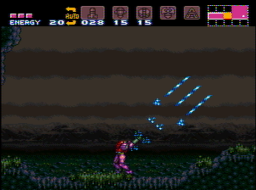

# Super Metroid Co-Op (two Samuses in a trench coat)

One player controls the legs, one player controls the arms. This may end up in some horrific spine-bending action for poor Samus:



Download release from [Metroid Construction](https://github.com/nstbayless/sm-coop).

## Build instructions

### ROM

Place `base.sfc` in the root of this directory, crc32 `d63ed5f8`.

### Dependencies

- `asar` v.1.9.1
- `python3`

### Build

On linux (or Windows via WSL, Git Bash, MSYS2, Cygwin)

```bash
./build.sh
```

Should produce `out/sm-coop.ips` (patch file) and `out/sm-coop.sfc` (patched ROM).